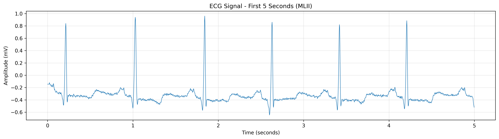
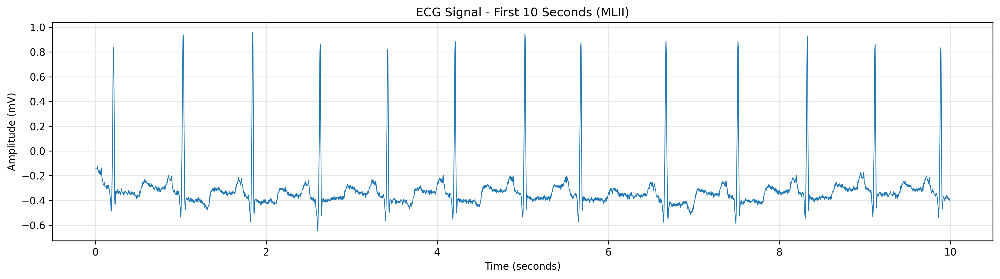
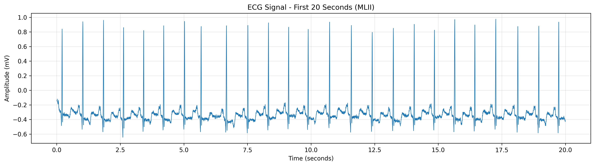
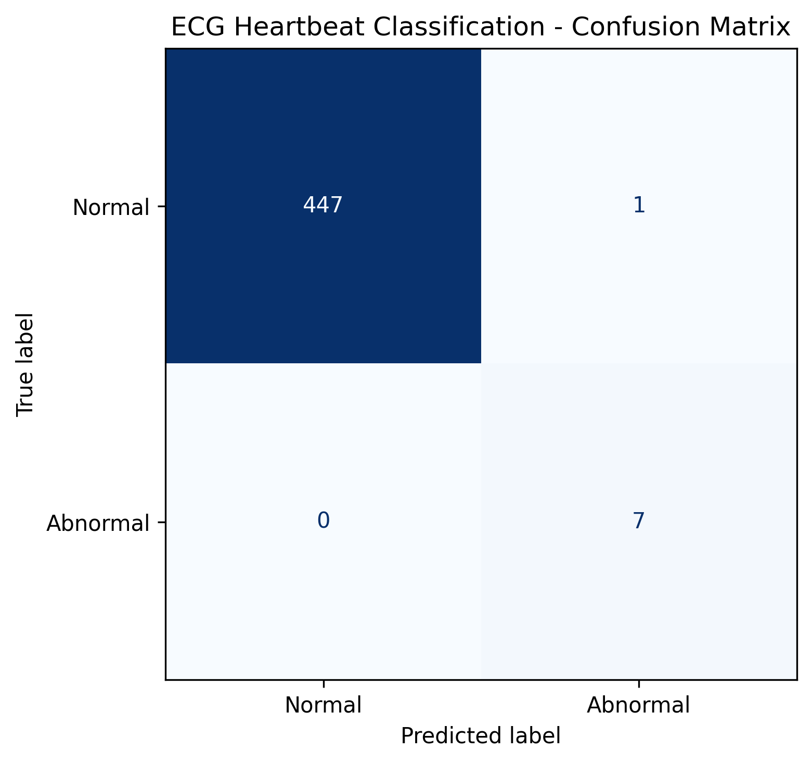

# ECG Signal Visualization and Classification

An educational Data Science project that explores Electrocardiogram (ECG) signals and uses Machine Learning to classify heartbeat segments as normal or selected abnormal beats.

## Project Overview

Electrocardiography (ECG) records the electrical activity of the heart. Visualizing ECG waveforms helps us observe patterns in cardiac signals, while Machine Learning can be used to explore differences between annotated heartbeat classes.

This project uses the **MIT-BIH Arrhythmia Database** to visualize ECG waveforms at different time intervals, inspect signal quality, extract heartbeat segments, and train a Logistic Regression model for binary heartbeat classification.

> **Disclaimer:** This project is for educational purposes only. It is not a medical diagnostic tool and must not be used to make clinical decisions.

## Objectives

- Load and explore ECG recordings and their annotations.
- Visualize ECG waveforms over 5-, 10-, and 20-second intervals.
- Assess signal quality and check for missing or non-finite values.
- Extract fixed-length heartbeat segments from annotated ECG signals.
- Classify normal and selected abnormal heartbeat segments using Logistic Regression.
- Evaluate the model using accuracy, precision, recall, F1-score, a classification report, and a confusion matrix.

## Dataset

**MIT-BIH Arrhythmia Database**

- Source: [PhysioNet — MIT-BIH Arrhythmia Database](https://physionet.org/content/mitdb/1.0.0/)
- Recording used for waveform visualization: Record 100
- Training recordings: 100, 101, 103, 105, 108, 112, 114, 116, 119, 200, 201, and 203
- Held-out test recording: 106
- Sampling frequency: 360 Hz
- ECG channels in record 100: MLII and V5

The database is accessed through the `wfdb` Python library. The raw dataset is not included in this repository.

## Target Variable

The project uses two target classes:

| Annotation | Label | Meaning |
|---|---:|---|
| N | 0 | Normal beat |
| A | 1 | Atrial premature beat |
| V | 1 | Premature ventricular contraction |

The selected abnormal annotations are combined into one class. Other annotation symbols are excluded from this binary classification experiment.

## Methodology

### 1. Data Loading and Understanding

- Loaded ECG signals and reference annotations using `wfdb`.
- Inspected the sampling frequency, channel names, signal dimensions, duration, and annotation symbols.
- Examined basic signal statistics, including minimum, maximum, mean, and standard deviation.

### 2. ECG Visualization

Generated separate waveform plots for the first 5, 10, and 20 seconds of the MLII channel.

### 3. Data Quality and Preprocessing

- Checked for missing (`NaN`) and infinite values.
- Selected the relevant heartbeat annotations (`N`, `A`, and `V`).
- Extracted 252-sample segments, containing 90 samples before and 162 samples after each annotated beat.
- Removed segments that crossed signal boundaries or contained non-finite values.
- Encoded the target labels as normal (0) and selected abnormal (1).

Each segment represents approximately 0.7 seconds of ECG data at 360 Hz.

### 4. Model Training

- **Algorithm:** Logistic Regression
- **Preprocessing:** StandardScaler within a Scikit-learn pipeline
- **Class imbalance handling:** `class_weight="balanced"`
- **Evaluation strategy:** Training on multiple recordings and testing on the separate, held-out record 106.

### 5. Evaluation

The model was evaluated using accuracy, abnormal-class precision, abnormal-class recall, F1-score, a classification report, and a confusion matrix.

### Interpretation

The model achieved high precision for the selected abnormal class, meaning most beats it predicted as abnormal were abnormal according to the dataset annotations. However, its recall was 61.92%, meaning it failed to identify some annotated abnormal beats.

These results apply to this particular experiment and held-out recording. They do not establish clinical reliability or guarantee similar performance on other recordings.

## Visualizations

### ECG waveform — 5 seconds

### ECG waveform — 10 seconds

### ECG waveform — 20 seconds

### Confusion matrix

The confusion matrix illustrates the relationship between the true and predicted heartbeat classes.

## Technologies Used

- Python
- NumPy
- Pandas
- Matplotlib
- WFDB
- Scikit-learn
- Google Colab 

## Limitations

- The model combines two types of abnormal beats into a single class.
- The held-out evaluation uses only one test recording.
- Differences between recordings and class imbalance can affect model performance.
- The current model uses raw ECG segment samples as features.
